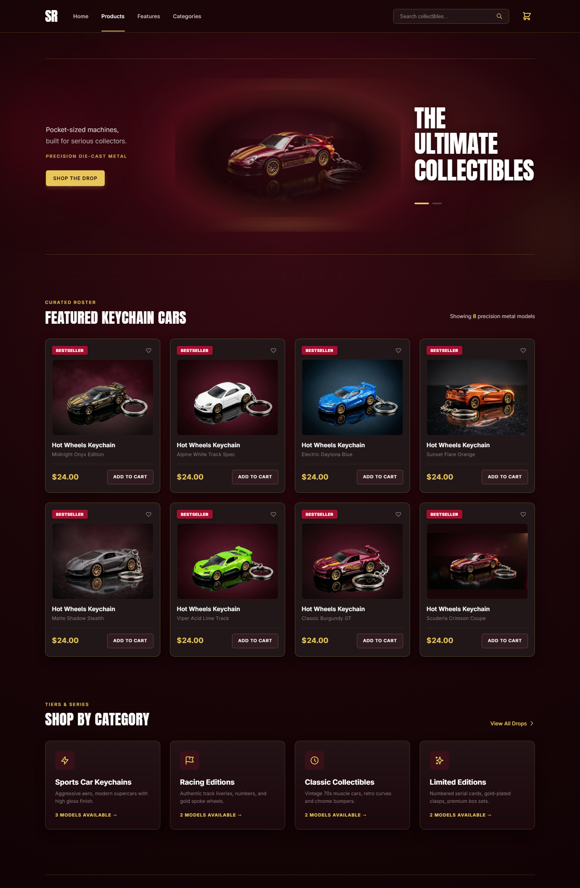
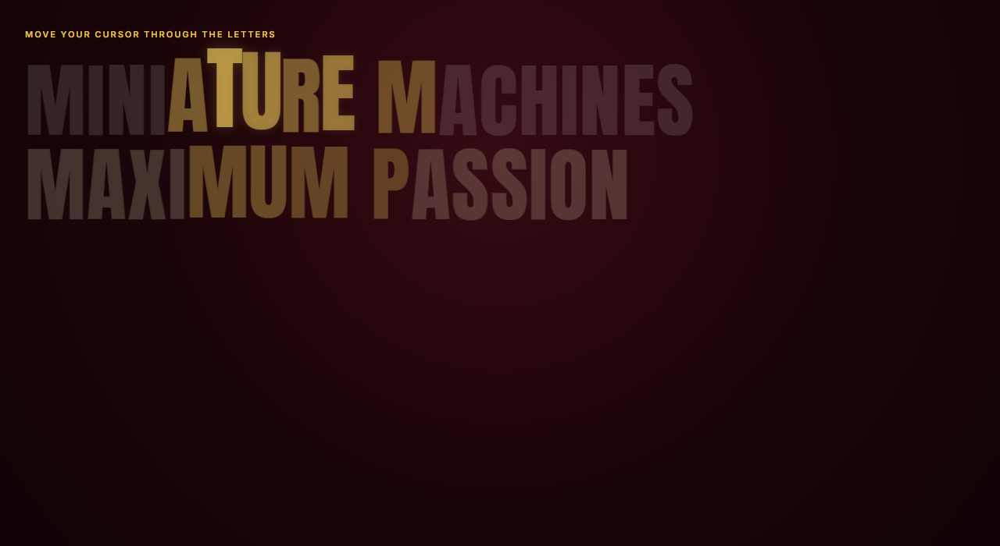
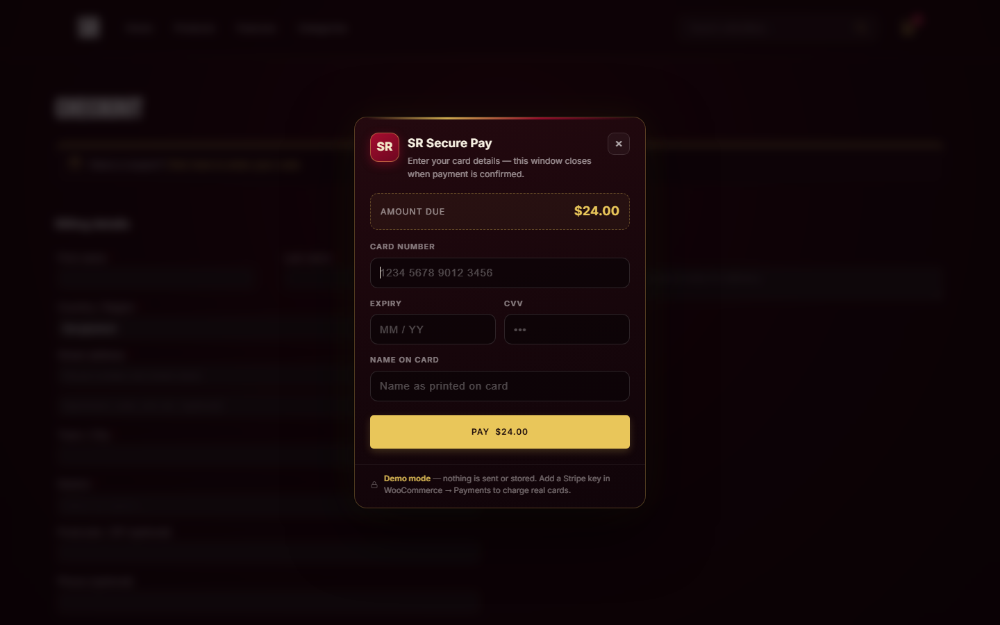

# SR Collectibles

A dark, burgundy-and-gold ecommerce experience for die-cast collectible keychains — built as a fully custom WordPress theme with WooCommerce, a bespoke card-payment popup, and a homepage full of motion design.

**Live demo (static export):** https://shazid41.github.io/sr-collectibles/



## Highlights

- **Cinematic hero carousel** — two AI-generated 1792px plates (burgundy Porsche 911 GT3 / onyx muscle car), razor-sharp, mask-blended into the page with no box or border, reliable autoplay + swipe + keyboard support
- **Cursor statement section** — giant display type where letters rise, scale and glow gold around the pointer, with a slow idle sine wave on touch devices
- **Full WooCommerce store** — product catalog, categories, cart, checkout, coupons, order emails, all re-skinned to the theme
- **Card payment popup** — dark-glass modal on checkout with live card-brand detection (Visa / Mastercard / Amex), Luhn validation, animated success check; Stripe-ready gateway flips to live mode with one key
- **bKash gateway** — mobile-wallet option for local buyers
- **Zero page builders** — hand-written PHP templates, vanilla JavaScript, custom CSS design system

| Cursor effect | Checkout | Payment popup |
| --- | --- | --- |
|  |  |  |

## Tech stack

- WordPress + WooCommerce (HPOS), PHP 8 on XAMPP
- Custom theme `fh-collectibles` (templates, template-parts, `front-page.php`)
- Custom plugin `sr-payments` (gateways + demo-mode popup + preview mode)
- Vanilla JS carousel / cursor physics / popup (no frameworks)
- Fonts: Anton + Inter (self-hosted woff2), CSS custom-property design tokens

## Repository structure

```
├── docs/            Static export of the storefront (GitHub Pages)
├── screenshots/     Visual verification captures
├── src/
│   ├── themes/fh-collectibles/   Custom WordPress theme
│   ├── plugins/sr-payments/      Card + bKash gateways, payment popup
│   └── mu-plugins/               Preview helpers
└── tools/          Build scripts used to produce docs/
```

The static demo in `docs/` is generated with Simply Static — cart and checkout actions
need the live WordPress backend and are non-functional there.

## Running locally

1. Install WordPress + WooCommerce on a local stack (e.g. XAMPP, PHP 8+)
2. Copy `src/themes/fh-collectibles` into `wp-content/themes/` and activate
3. Copy `src/plugins/sr-payments` into `wp-content/plugins/` and activate
4. Create products in WooCommerce and set a static front page

**Payments:** the card gateway runs in demo mode until a Stripe secret key is added
(WooCommerce → Settings → Payments → Cards). The bKash number is a placeholder.
In demo mode nothing is charged, sent, or stored.

## License & usage terms

**All Rights Reserved.** © 2026 Md Shazidur Rahaman.

You may view and browse this repository for evaluation and portfolio purposes.
You may **not** copy, redistribute, republish, sublicense, or use this code or its
design assets in other projects, commercial or otherwise, without written
permission from the author.

WordPress and WooCommerce core are GPL-licensed by their respective authors; this
notice applies to the original theme, plugin, and design assets in this repository.

> **A note on technical reality:** a public GitHub repository cannot *technically*
> prevent downloads or forks — Git does not work that way. This repository avoids
> publishing secrets (`wp-config.php`, credentials, database dumps) and the product
> database, so it cannot be deployed as-is; the license terms above govern what is
> legally permitted with the published code.

Made with care in Bangladesh.
